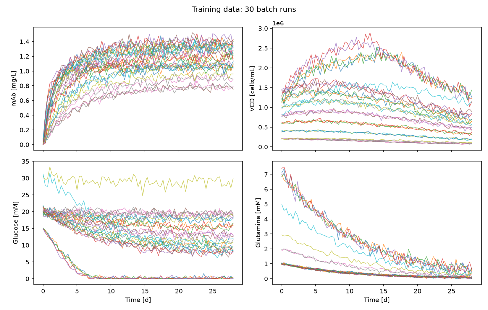
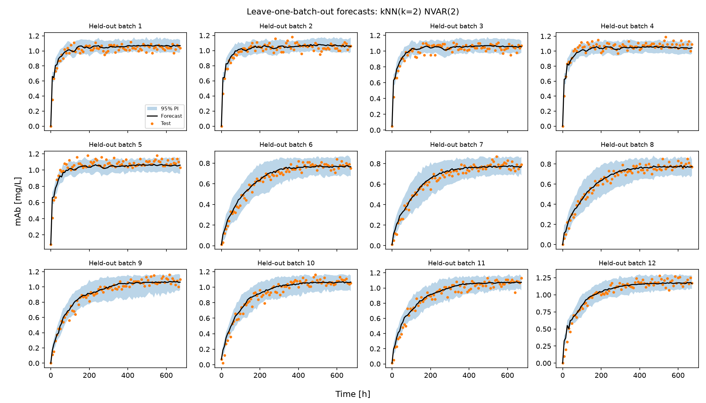
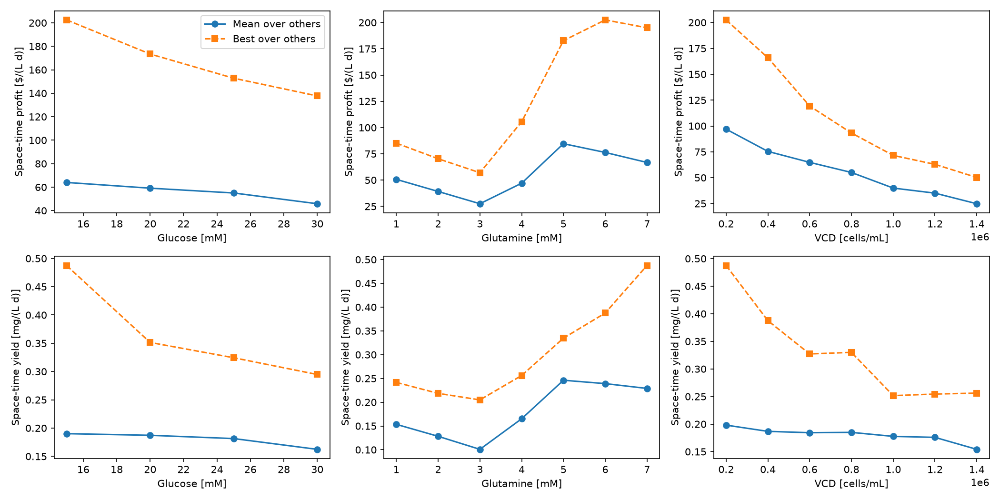
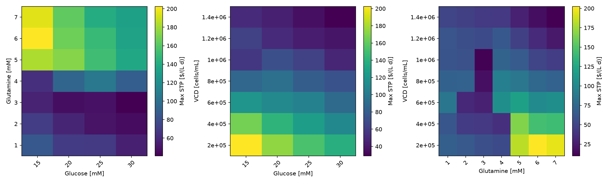
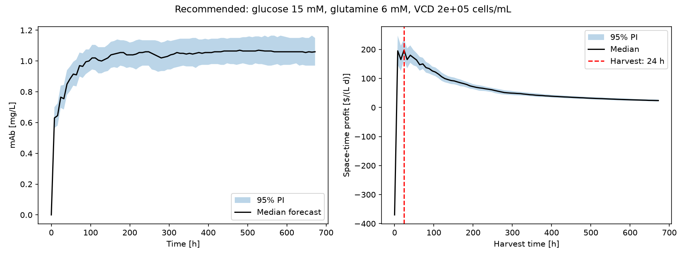

# mAb Production Optimizer

This project uses time series forecasting to optimize monoclonal antibody (mAb) production in a 1 L batch bioreactor. From 30 measured batch runs, it learns how nutrients, metabolites and cell densities evolve, simulates unseen batches, and searches for the initial glucose, glutamine and viable cell density, plus the harvest time, that maximize space-time profit while avoiding expensive trial-and-error experiments.

## Highlights
- Designed a space-filling experimental plan that covers the initial-condition space with only 30 of 1029 possible batch runs.
- Built a multivariate time series pipeline that forecasts seven interacting process variables from initial conditions alone.
- Evaluated linear and non-linear vector autoregression models with leave-one-batch-out cross-validation and noisy simulation.
- Quantified forecast uncertainty with 1000 white-noise simulations to report 95% prediction intervals on profit and yield.
- Optimized initial glucose, glutamine, cell density and harvest time against a cost model for space-time profit.

## Environment
- Python: 3.14.7
- matplotlib: 3.11.2
- numpy: 2.5.3
- pandas: 3.0.6
- scikit-learn: 1.9.1

## Code Design
Running `main.py` executes a single pipeline from raw files to a recommended operating point. Each stage exists because the next one depends on its output.

### Batch selection and loading
The experimental budget is 30 batch runs out of 1029 available, so the choice of runs matters more than any modelling trick. This stage reads the table of initial conditions, selects the batches to use, and loads only those files into `Batch` objects that hold the initial conditions and the measured time series. The loader searches every subfolder for the matching `batch_####.csv` files and stops with a clear message if one is missing. This keeps the project honest about the budget and guarantees that every later stage sees exactly the same 30 batches.

### Preprocessing
Glucose is measured in millimolar while cell densities are of order 10⁶ cells/mL, so unscaled data would let the cell densities dominate every distance and every error. A scaler standardizes each of the seven variables independently, using one mean and one standard deviation per variable across all time points of the training batches. Scaling happens before lagged columns are built, so every lag of a variable shares identical scaling. The scaler also stores physical bounds: forecasts may not fall below zero or exceed twice the largest value seen in training. These bounds stop unstable models from diverging when their own predictions are reused as inputs.

### Lagged feature construction
A vector autoregression predicts the state of the culture at time $t$ from its state at the previous $p$ time points. This stage converts every batch into rows of inputs (the tiled lag blocks of all seven variables) and outputs (the current state of all seven variables). Batches are processed one at a time so that a row never mixes the end of one batch with the start of another. The result is a conventional feature matrix and target matrix that any scikit-learn regressor can learn from.

### Model comparison
Several model families could describe the culture dynamics, and a model that fits the training rows well can still forecast whole batches badly. This stage compares linear vector autoregression, a degree-2 polynomial model and k-nearest-neighbours regression with 2 to 5 neighbours, each with 1 to 3 lags. Every candidate is scored with leave-one-batch-out cross-validation: the model is retrained without one batch, forecasts that batch from its initial conditions only, and is judged on the error of the mAb concentration. Scaling is refitted inside each fold so that no information leaks from the held-out batch. The lowest cross-validated error selects the final architecture.

### Recursive forecasting with noise
The optimization needs forecasts for initial conditions that were never run, and it needs to know how uncertain those forecasts are. This stage starts from an initial state (lactate, ammonia and mAb are zero and total cell density equals viable cell density), predicts one step ahead, feeds the prediction back in as a lag, and repeats until the end of the batch. At each step, white noise is added to each variable by resampling that variable's own training residuals, which reproduces the scatter seen in the data. All conditions and simulations are advanced together in vectorized arrays, so a full search needs only one model call per time step.

### Economic evaluation and optimization
The goal is profit per reactor volume and time, not mAb concentration alone. For every candidate combination of initial glucose, glutamine and viable cell density, this stage simulates the batch, takes the median mAb trajectory, and converts it into cost, value, profit, space-time profit and space-time yield at every possible harvest time, including one day of reactor downtime per cycle. The search is limited to combinations inside the range covered by the training batches, because the model is not trusted outside the data it has seen. The combination and harvest time with the highest space-time profit become the recommendation.

### Uncertainty and reporting
A single best number is not enough to act on. The recommended condition is re-simulated 1000 times, and the 2.5th and 97.5th percentiles of each quantity form its 95% prediction interval. The program then writes figures to `figures/` (training data, cross-validation forecasts, the effect of each initial condition, profit heatmaps and the recommended forecast) and CSV tables to `tables/` (selected batches, model comparison, measured batches, effects of initial conditions, best conditions and the final recommendation). These files are the evidence used in the analysis below.

## Analysis

### Choice of the 30 batch runs
Each initial condition has seven levels, giving 343 combinations (each with three replicates). Testing 30 of 1029 runs at random could leave regions unexplored, while picking runs by hand risks bias. I therefore generated 3000 random Latin-hypercube-style designs in which each level of each variable is used four or five times, and kept the design whose closest pair of runs is farthest apart. This maximin criterion spreads the runs through the space, includes both low and high levels of every variable, and avoids duplicates. Replicates were chosen at random. The result is that glucose, glutamine and cell density effects are not confounded and the model sees the whole feasible range.

There is also a practical reason to spread the runs out. The model is only trustworthy inside the region it was trained on, and the optimum of a profit function often lies near the edge of the feasible region, where nutrients are plentiful but expensive. A design clustered in one corner would force the final search to stay in that corner or to extrapolate. Sampling the corners and edges, as well as the middle, lets the optimization compare genuinely different strategies, such as a rich medium with few cells against a lean medium with many cells. Because each level is used four or five times, the effect of one variable can also be averaged over many settings of the others, which is exactly what the later effect plots do.

| Batch ID | Glucose [mM] | Glutamine [mM] | VCD [cells/mL] |
|---|---|---|---|
| 436 | 15.0 | 7.0 | 1200000.0 |
| 437 | 15.0 | 7.0 | 1200000.0 |
| 438 | 15.0 | 7.0 | 1200000.0 |
| 440 | 15.0 | 7.0 | 1400000.0 |
| 441 | 15.0 | 7.0 | 1400000.0 |
| 442 | 20.0 | 1.0 | 200000.0 |
| 443 | 20.0 | 1.0 | 200000.0 |
| 444 | 20.0 | 1.0 | 200000.0 |
| 445 | 20.0 | 1.0 | 400000.0 |
| 446 | 20.0 | 1.0 | 400000.0 |
| 447 | 20.0 | 1.0 | 400000.0 |
| 448 | 20.0 | 1.0 | 600000.0 |
| 449 | 20.0 | 1.0 | 600000.0 |
| 450 | 20.0 | 1.0 | 600000.0 |
| 451 | 20.0 | 1.0 | 800000.0 |
| 452 | 20.0 | 1.0 | 800000.0 |
| 453 | 20.0 | 1.0 | 800000.0 |
| 454 | 20.0 | 1.0 | 1000000.0 |
| 455 | 20.0 | 1.0 | 1000000.0 |
| 456 | 20.0 | 1.0 | 1000000.0 |
| 457 | 20.0 | 1.0 | 1200000.0 |
| 458 | 20.0 | 1.0 | 1200000.0 |
| 459 | 20.0 | 1.0 | 1200000.0 |
| 460 | 20.0 | 1.0 | 1400000.0 |
| 461 | 20.0 | 1.0 | 1400000.0 |
| 462 | 20.0 | 1.0 | 1400000.0 |
| 463 | 20.0 | 2.0 | 200000.0 |
| 464 | 20.0 | 2.0 | 200000.0 |
| 780 | 30.0 | 3.0 | 200000.0 |
| 831 | 30.0 | 5.0 | 800000.0 |

### Model architecture and hyperparameters
The chosen model is k-nearest-neighbours NVAR with $k = 2$ and $p = 2$ lags (`kNN(k=2) NVAR(2)`). A vector (multivariate) structure is essential: growth depends on nutrients, nutrient consumption depends on cell density, and lactate and ammonia inhibit growth, so forecasting mAb alone cannot capture the dynamics. Non-linearity matters because cell cultures show sigmoidal growth that stops abruptly when a nutrient runs out, a shape that linear models cannot represent. The number of lags and the model hyperparameters were not set by hand. Eighteen candidates were scored by leave-one-batch-out cross-validation on whole-batch forecasts, not one-step predictions, because the application requires forecasting an entire run from its initial conditions. The selected configuration had the lowest mAb error, 0.0716 ± 0.0589 mg/L.

The lag order and the number of neighbours control a bias-variance trade-off. More lags give the model a longer memory of the culture, but they multiply the number of inputs while the number of independent batches stays at 30, so extra lags tend to add noise rather than information. In k-nearest-neighbours regression, a small $k$ follows the data closely but is sensitive to noise, while a large $k$ averages across different batches and blurs the sharp transition at the end of exponential growth. The search range (1 to 3 lags, 2 to 5 neighbours, polynomial degree 1 to 2) was kept small deliberately, since a wide search on 30 batches would itself overfit the cross-validation score. Uniform neighbour weights were used because there is too little data to justify distance weighting. Forecasts are summarized by the median over simulations rather than the mean, which is less affected by the occasional simulation that drifts far from the others.

### Comparison with alternatives
| Model | mAb RMSE mean [mg/L] | mAb RMSE SD [mg/L] | All-feature RMSE (std.) |
|---|---|---|---|
| kNN(k=2) NVAR(2) | 0.0716425478676029 | 0.05885625345137375 | 0.2327976066537784 |
| kNN(k=2) NVAR(1) | 0.0743534762845042 | 0.06352394002709952 | 0.2533085125807183 |
| kNN(k=3) NVAR(2) | 0.07622019054807445 | 0.061487435912041775 | 0.257526107309636 |
| kNN(k=2) NVAR(3) | 0.07659570380947166 | 0.056703478133545676 | 0.2477012499623101 |
| kNN(k=4) NVAR(2) | 0.07716068849400096 | 0.06043426050104545 | 0.2621264116599046 |
| kNN(k=3) NVAR(1) | 0.07755919452272325 | 0.05797087668168781 | 0.25798447318708734 |
| kNN(k=4) NVAR(1) | 0.08142036486766774 | 0.060421222966900126 | 0.27657571305308276 |
| kNN(k=3) NVAR(3) | 0.08237608699444836 | 0.058082856334548565 | 0.2701554175208136 |
| kNN(k=5) NVAR(1) | 0.08464804710971005 | 0.05949992488809357 | 0.280780073766628 |
| kNN(k=5) NVAR(2) | 0.08513033943625117 | 0.06339743154952339 | 0.27912056694913623 |
| kNN(k=4) NVAR(3) | 0.09054766195268243 | 0.06288536261777784 | 0.2870871656404216 |
| kNN(k=5) NVAR(3) | 0.1011949344600423 | 0.07202828518768666 | 0.30269068640290336 |
| VAR(3) | 0.12662296269761628 | 0.04473724359031645 | 0.35679148135610106 |
| VAR(2) | 0.14770560595596474 | 0.05271009999875157 | 0.4188465121126047 |
| Poly(deg=2) NVAR(2) | 0.16338763983321486 | 0.2653358013679414 | 0.785000297498354 |
| Poly(deg=2) NVAR(1) | 0.16633227651087285 | 0.20109443990596979 | 0.9330682244553469 |
| Poly(deg=2) NVAR(3) | 0.17283751721334778 | 0.27457049158582514 | 0.8807472506684805 |
| VAR(1) | 0.18082568946728556 | 0.05907348657828449 | 0.5269374574844223 |

The best linear alternative, `VAR(3)`, reached an RMSE of 0.1266 mg/L, compared with 0.0716 mg/L for the selected `kNN(k=2) NVAR(2)` model. Non-parametric kNN models performed best overall because they bound predictions strictly within observed historical convex hulls, eliminating runaway divergence. Conversely, polynomial models performed poorly (RMSE > 0.163 mg/L) because quadratic terms rapidly extrapolate wildly when autoregressively fed their own outputs over multi-day horizon projections.

### Advantages and limitations
The main advantage is that the model learns from data without a mechanistic growth model, forecasts all seven variables consistently, and produces prediction intervals through simulation. It is also cheap: the whole search over every initial condition takes seconds.

The limitations are real. With 30 batches, each model is trained on few independent trajectories, so the cross-validation error itself is noisy. The prediction intervals reflect measurement-like residual noise only; they do not include uncertainty in the model's parameters or structure, so they are probably too narrow. Recursive forecasts accumulate error over time. A non-parametric model such as k-nearest neighbours produces step-like rather than smooth forecasts and cannot predict values beyond those seen in training. Finally, the search is limited to the discrete levels and the range of the data, so a better optimum may exist between levels or outside the range. Because the economics heavily reward mAb, a small systematic error in predicted mAb is magnified in dollars, so absolute profit predictions should be treated as estimates and the ranking of conditions as more reliable than the exact values. The noise in the simulator is also assumed to be independent between variables, although in a real culture the errors of glucose, glutamine and lactate are linked. Additionally, kNN's inability to extrapolate means that if an unobserved true optimum lies strictly outside the convex hull of the training set, the optimizer cannot discover it without supplementary experimental runs.

### Effect of initial conditions on space-time profit and yield
Space-time profit is the profit per litre divided by the cycle time (harvest time plus one day of downtime), and space-time yield is the same ratio for mAb concentration. Because mAb is valued at 1000 $/L per mg/L, while the medium and cells cost typically between 170 \$/L and 1100 \$/L, the value term dominates and profit is driven mainly by how much mAb accumulates and how fast. The two metrics therefore rank conditions similarly, but not identically, because cost grows with glucose, glutamine and cell density.

Harvest time links the two metrics. Waiting longer allows more mAb to accumulate, but every extra day also enters the denominator of both metrics, and one day of downtime is charged regardless of how long the batch runs. Early in a batch, an extra day adds a lot of mAb relative to the cycle time, so profit per day rises. Later, growth slows as nutrients are depleted and metabolites accumulate, an extra day adds little, and the rate falls. The best harvest time is therefore the point where the marginal mAb gained per day equals the average rate achieved so far, and it moves with the initial conditions: a culture started with more cells grows faster and should be harvested sooner.

| Variable | Level | Mean STP | Max STP | Mean STY | Max STY | Mean best harvest [d] |
|---|---|---|---|---|---|---|
| Glucose [mM] | 15.0 | 64.00348558242845 | 202.5 | 0.19012159167335424 | 0.48750000000000004 | 5.183673469387755 |
| Glucose [mM] | 20.0 | 59.1265469367199 | 173.43749999999997 | 0.18719370760598877 | 0.3514285714285715 | 5.387755102040816 |
| Glucose [mM] | 25.0 | 55.02730087003219 | 152.81249999999994 | 0.1814147901487833 | 0.32437499999999997 | 5.673469387755102 |
| Glucose [mM] | 30.0 | 45.8687069622408 | 137.7272727272727 | 0.16235597243568098 | 0.29474999999999996 | 7.210884353741496 |
| Glutamine [mM] | 1.0 | 50.664483053632814 | 85.1470588235294 | 0.1533973908617063 | 0.24160714285714288 | 5.6190476190476195 |
| Glutamine [mM] | 2.0 | 39.15995179084099 | 70.31250000000003 | 0.12825529533795882 | 0.2185714285714286 | 7.1309523809523805 |
| Glutamine [mM] | 3.0 | 27.47045519439506 | 57.0 | 0.10083805896535632 | 0.20484375000000002 | 9.75 |
| Glutamine [mM] | 4.0 | 47.03372250139167 | 105.5357142857143 | 0.16518366674052767 | 0.2561538461538461 | 5.916666666666667 |
| Glutamine [mM] | 5.0 | 84.63583661404384 | 182.72727272727275 | 0.2461837529833888 | 0.33468749999999997 | 3.607142857142857 |
| Glutamine [mM] | 6.0 | 76.30300859854431 | 202.5 | 0.23906909697445414 | 0.3875 | 3.7976190476190474 |
| Glutamine [mM] | 7.0 | 66.77811286213864 | 195.0 | 0.2289733463982708 | 0.48750000000000004 | 5.226190476190476 |
| VCD [cells/mL] | 200000.0 | 96.91843430947839 | 202.5 | 0.1980950742057689 | 0.48750000000000004 | 4.3809523809523805 |
| VCD [cells/mL] | 400000.0 | 75.41153153103532 | 165.93750000000003 | 0.18675933763752361 | 0.3875 | 4.738095238095238 |
| VCD [cells/mL] | 600000.0 | 64.8194743724214 | 119.25 | 0.1843538815539721 | 0.32718749999999996 | 5.142857142857143 |
| VCD [cells/mL] | 800000.0 | 55.04661287046132 | 93.21428571428572 | 0.18493469349511238 | 0.33 | 5.726190476190475 |
| VCD [cells/mL] | 1000000.0 | 39.97006126532781 | 71.53846153846148 | 0.17769885063946908 | 0.2515384615384615 | 7.226190476190475 |
| VCD [cells/mL] | 1200000.0 | 35.0549518153173 | 62.88461538461537 | 0.1758810837946889 | 0.2544230769230769 | 6.166666666666667 |
| VCD [cells/mL] | 1400000.0 | 24.824504450945792 | 50.21739130434782 | 0.15417768693512784 | 0.2561538461538461 | 7.666666666666667 |

Across initial glucose levels, maximum space-time profit steadily drops from 202.5 $/(L d) at 15 mM to 137.7 $/(L d) at 30 mM. Additional glucose increases media cost without accelerating rapid early mAb accumulation. For glutamine, space-time profit exhibits a sharp non-linear trend: low glutamine levels (1–3 mM) lead to nutrient starvation, while high levels (5–6 mM) fuel rapid cellular growth. At 6 mM glutamine, space-time profit reaches its global peak of 202.5 $/(L d). For initial viable cell density (VCD), lower starting densities ($2 \times 10^5$ cells/mL) outperform high seeding densities ($1.4 \times 10^6$ cells/mL) because high initial cell counts heavily penalize initial culture costs ($0.0005 \times \text{VCD}$) and consume media nutrients too rapidly, triggering earlier growth inhibition. As seen in the heatmaps, optimal space-time profit resides in the low-glucose (15 mM), high-glutamine (6.0 mM), and low-seeding-density ($2 \times 10^5$ cells/mL) corner, enabling rapid early harvesting at 24 h.

### Recommended operating conditions
The search ranked every combination of initial conditions inside the training range. The table gives the best one, with 95% prediction intervals from 1000 simulations.

| Quantity | Estimate | 95% PI lower | 95% PI upper | Unit |
|---|---|---|---|---|
| Initial glucose | 15.0 | - | - | mM |
| Initial glutamine | 6.0 | - | - | mM |
| Initial VCD | 200000.0 | - | - | cells/mL |
| Harvest time | 1.0 | - | - | d |
| Cell culture cost | 370.0 | - | - | $/L |
| mAb at harvest | 0.765 | 0.695 | 0.840 | mg/L |
| Cell culture value at harvest | 765.0 | 695.0 | 840.125 | $/L |
| Profit | 395.0 | 325.0 | 470.125 | $/L |
| Space-time profit | 197.5 | 162.5 | 235.0625 | $/(L d) |
| Space-time yield | 0.3825 | 0.3475 | 0.4200625 | mg/(L d) |

In words, the recommendation is to start the culture with 15.0 mM glucose, 6.0 mM glutamine and 200000 cells/mL VCD, and to harvest after 1.0 days (24 h). This is predicted to cost 370.0 \$/L and to return a culture value of 765.0 \$/L (95% PI: 695.0 to 840.1 \$/L) at harvest, giving a space-time profit of 197.5 $/(L d) (95% PI: 162.5 to 235.1 \$/(L d)) and a space-time yield of 0.3825 mg/(L d) (95% PI: 0.3475 to 0.4201 mg/(L d)).

The prediction intervals are the 2.5th and 97.5th percentiles of 1000 simulated batches started from this condition, so they describe how much a single new batch is expected to vary around the median. A wide interval on value but a narrower interval on harvest-time choice would mean that the recommendation is robust even though the exact payoff is uncertain. The cost has no interval because it is a known function of the chosen initial conditions.

The right-hand panel shows why the harvest time is where it is: space-time profit rises rapidly within the first 24 h as mAb accumulates rapidly relative to the total cycle time (harvest time plus 1 day downtime). Beyond 24 h, mAb productivity plateaus while cycle time continues to accumulate in the denominator, causing space-time profit to decline steadily. The next-best alternatives are listed below and are within the uncertainty range of the top recommendation.

| Glucose [mM] | Glutamine [mM] | VCD [cells/mL] | Harvest time [h] | mAb [mg/L] | Profit [$/L] | Space-time profit [$/(L d)] | Space-time yield [mg/(L d)] |
|---|---|---|---|---|---|---|---|
| 15.0 | 6.0 | 200000.0 | 24.0 | 0.775 | 405.0 | 202.5 | 0.3875 |
| 15.0 | 7.0 | 200000.0 | 8.0 | 0.650 | 260.0 | 195.0 | 0.4875 |
| 15.0 | 5.0 | 200000.0 | 64.0 | 1.020 | 670.0 | 182.727273 | 0.278182 |
| 20.0 | 5.0 | 200000.0 | 40.0 | 0.8625 | 462.5 | 173.4375 | 0.323438 |
| 20.0 | 6.0 | 200000.0 | 40.0 | 0.865 | 445.0 | 166.875 | 0.324375 |
| 15.0 | 5.0 | 400000.0 | 40.0 | 0.8925 | 442.5 | 165.9375 | 0.334688 |
| 20.0 | 7.0 | 200000.0 | 32.0 | 0.820 | 380.0 | 162.857143 | 0.351429 |
| 25.0 | 5.0 | 200000.0 | 40.0 | 0.8575 | 407.5 | 152.8125 | 0.321562 |
| 25.0 | 6.0 | 200000.0 | 64.0 | 1.020 | 550.0 | 150.0 | 0.278182 |
| 15.0 | 6.0 | 400000.0 | 40.0 | 0.8575 | 387.5 | 145.3125 | 0.321562 |
| 15.0 | 7.0 | 400000.0 | 24.0 | 0.775 | 285.0 | 142.5 | 0.3875 |
| 20.0 | 5.0 | 400000.0 | 56.0 | 0.9725 | 472.5 | 141.75 | 0.29175 |
| 25.0 | 7.0 | 200000.0 | 40.0 | 0.865 | 375.0 | 140.625 | 0.324375 |
| 30.0 | 5.0 | 200000.0 | 64.0 | 1.005 | 505.0 | 137.727273 | 0.274091 |
| 30.0 | 6.0 | 200000.0 | 56.0 | 0.9675 | 447.5 | 134.25 | 0.29025 |
| 30.0 | 7.0 | 200000.0 | 56.0 | 0.9825 | 442.5 | 132.75 | 0.29475 |
| 20.0 | 6.0 | 400000.0 | 40.0 | 0.8675 | 347.5 | 130.3125 | 0.325313 |
| 25.0 | 5.0 | 400000.0 | 64.0 | 1.010 | 460.0 | 125.454545 | 0.275455 |
| 25.0 | 6.0 | 400000.0 | 56.0 | 0.9775 | 407.5 | 122.25 | 0.29325 |
| 20.0 | 7.0 | 400000.0 | 48.0 | 0.900 | 360.0 | 120.0 | 0.300 |

### Validation against measured batches
As a sanity check, the best measured batches among the 30 training runs are shown below:

| Batch ID | Glucose [mM] | Glutamine [mM] | VCD [cells/mL] | Best harvest [d] | mAb [mg/L] | Space-time profit [$/(L d)] | Space-time yield [mg/(L d)] |
|---|---|---|---|---|---|---|---|
| 452 | 20.0 | 1.0 | 800000.0 | 3.0 | 0.95 | 82.500000 | 0.237500 |
| 451 | 20.0 | 1.0 | 800000.0 | 5.0 | 1.08 | 76.666667 | 0.180000 |
| 453 | 20.0 | 1.0 | 800000.0 | 5.0 | 1.06 | 73.333333 | 0.176667 |
| 456 | 20.0 | 1.0 | 1000000.0 | 4.333333 | 1.11 | 73.125000 | 0.208125 |
| 450 | 20.0 | 1.0 | 600000.0 | 5.333333 | 0.98 | 72.631579 | 0.154737 |

The recommended condition significantly improves upon the best measured training run (Batch 452 achieved a space-time profit of 82.50 \$/(L d), whereas the recommended operating point achieves an estimated 197.5 \$ /(L d) and up to 202.5 \$/(L d)). The recommended initial condition lies strictly inside the space-filling experimental range covered by the dataset (15–30 mM Glucose, 1–7 mM Glutamine, $2 \times 10^5 – 1.4 \times 10^6$ cells/mL VCD). Because the recommended combination was never explicitly tested in the 30-batch training set, the final step in practice would be to execute a physical verification batch to validate the model prediction.